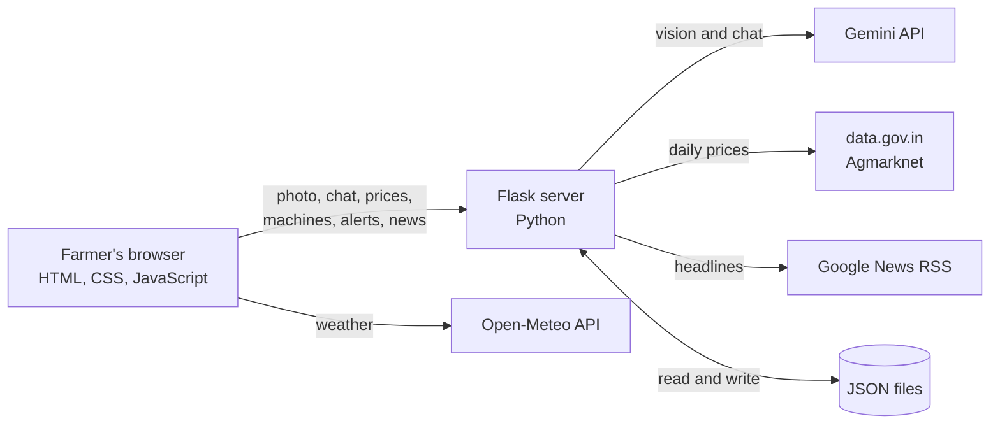

# AgriExpert

**An all-in-one AI farming companion for small farmers, in Hindi and English, by text or voice.**

I am Rohan 1st year student, i build the all in one solution for farmers which is AgriExpert 

Agriculture and Rural Development track.

## The problem

Small farmers can't spot crop disease early, so they use the wrong pesticide and lose yield and money. They also don't know fair market prices, can't afford machines like tractors, and have no one to guide them. Today they jump between apps, WhatsApp groups, mandi sites and news.

## Our idea

> A chatbot helps one farmer. **AgriExpert protects a whole village**, and puts everything a farmer needs in one place.

## Features

| Feature | What it does | Status |
|---|---|---|
| Disease Doctor | Upload a leaf photo and a short note. A vision AI returns the crop, disease, confidence, summary and 3 steps in Hindi or English, with voice | Working (Gemini API) |
| Village Alerts | Every diagnosis is saved anonymously with village, crop and disease. When 2 or more different farmers in a village report the same disease within 7 days, everyone there growing that crop gets an alert | Working logic. The demo uses simulated neighbour reports, labelled in the app |
| Weather + farming tips | Live weather and 7-day forecast with rule-based tips like "heavy rain: do not spray" | Working (Open-Meteo), fixed to Delhi |
| Crop Guide | Season, sowing and harvest time, days to grow, soil, water and diseases for 6 crops | Reference data, approximate, not yet expert-verified |
| Mandi Prices | Daily prices from Agmarknet through data.gov.in | Built. Shows labelled sample data unless `DATA_GOV_KEY` is set |
| Rent Machines | Farmers list machines and others send requests | Working, saved in `data/machines.json` |
| Farming News | Agriculture headlines in English or Hindi | Working (Google News RSS) |
| AI Chatbot | Farming-only guide with short memory | Working (Gemini API) |

## How it works



The API key lives only on the server in a `.env` file and is never sent to the browser.

## Safety choices

- The AI never gives pesticide doses. It tells the farmer to follow the product label and ask a local KVK or agriculture officer.
- If the photo is not a plant or is unclear, it says "Unclear" and asks for a better photo.
- A confidence level is always shown, with a note to confirm with an expert.
- The chatbot only answers farming questions.

## Tech stack

Python and Flask, plain HTML/CSS/JavaScript, Google Gemini API, Open-Meteo, Google News RSS, data.gov.in (Agmarknet), JSON file storage, browser text-to-speech.

## Run it locally

You need Python 3.9 or newer and a free Gemini API key from Google AI Studio.

```bash
git clone https://github.com/rohanin4906-droid/AgriExpert.git
cd AgriExpert
bash run.sh
```

`run.sh` creates a virtual environment, installs the requirements, asks for your Gemini API key once and saves it to `.env`, then starts the app at http://127.0.0.1:5050.

`.env` settings: `GEMINI_API_KEY` (required), `GEMINI_MODEL` (change it if Google retires the model), `GEMINI_FALLBACKS` (optional backups), `DATA_GOV_KEY` (optional, for live prices).

## Honest limitations

- We did **not** train a model. Detection uses a vision LLM through an API, and we have not measured its accuracy.
- Mandi prices are sample data unless a data.gov.in key is added. Agmarknet updates daily, not live.
- Village Alerts need many users to be truly useful. Villages are matched by typed name, and the demo neighbour reports are simulated.
- Crop facts are approximate and need verification with ICAR or KVK experts.
- No accounts, payments or offline mode. It runs locally and is not deployed.
- Photos are sent to Google's Gemini API, and free-tier content may be used by Google to improve its products.

## Roadmap